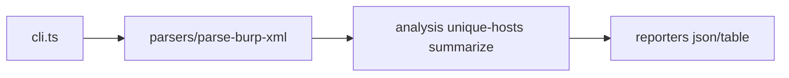

# hx-burp-export-cli — architecture

## Purpose

Reads Burp Suite XML export files, extracts HTTP items (URL, method, status), and
produces deduplicated host lists plus optional JSON for automation. Non-goals: live
proxy capture, Burp project binary formats, or active scanning.

## High-level flow

## Module map

| Path                              | Responsibility                               |
| --------------------------------- | -------------------------------------------- |
| `src/cli.ts`                      | Commander `hosts` command, `--out`, `--json` |
| `src/parsers/parse-burp-xml.ts`   | XML → `BurpItem[]` via fast-xml-parser       |
| `src/parsers/extract-url.ts`      | URL parsing from Burp item shape             |
| `src/parsers/xml-config.ts`       | Shared parser options                        |
| `src/analysis/unique-hosts.ts`    | Hostname deduplication                       |
| `src/analysis/summarize-items.ts` | Counts and export metadata                   |
| `src/reporters/`                  | JSON and table formatters                    |
| `src/utils/`                      | Safe URL helpers, text file read             |

## Extension

1. Add a parser variant under `src/parsers/` if Burp changes export shape.
2. Register new fields on `BurpItem` in `types.ts` and extend summarize.
3. Unit-test with fixture XML snippets — no network.
4. Run `npm test` and `npm run format:check`.

## Testing strategy

- **Unit**: XML parsing, URL extraction, host dedup, reporters (`*.spec.ts`).
- **Integration**: `tests/burp.test.ts` on committed fixtures.

## Ethics & scope

Authorized engagements only. See [SECURITY.md](./SECURITY.md).
